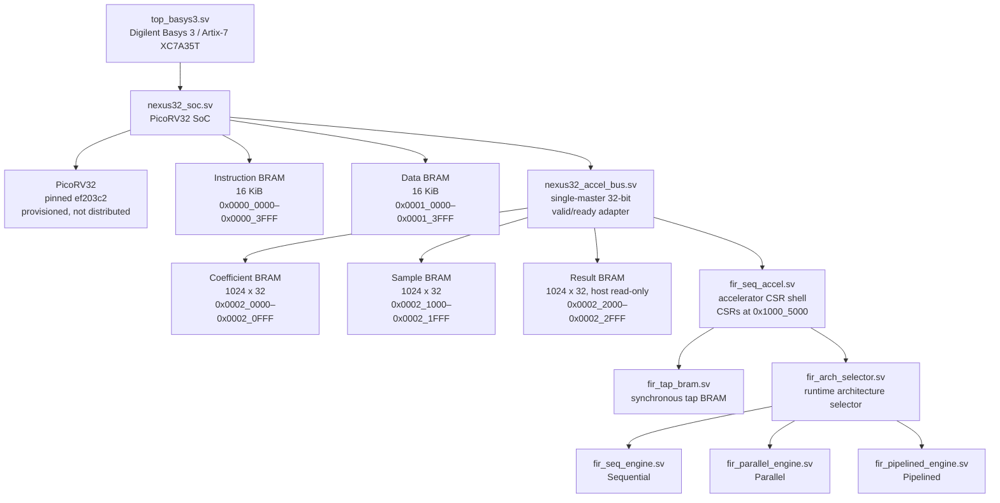
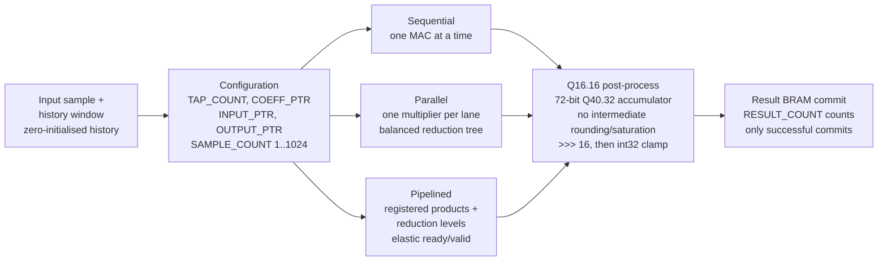
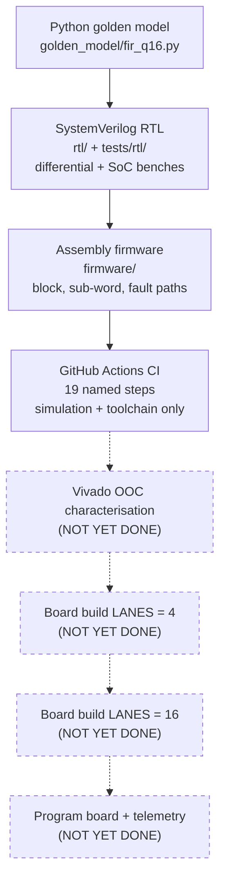
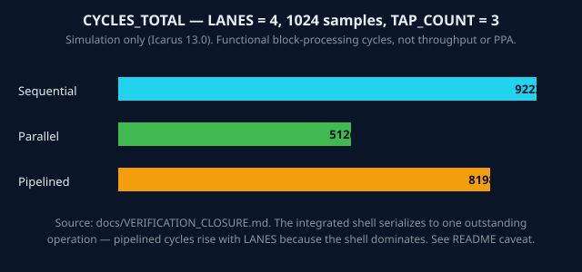

<div align="center">

# NEXUS-32 — PicoRV32 FIR SoC

**One SoC. Three FIR engines. One frozen Q16.16 contract. Every number below is simulation evidence — or it is labelled as not yet measured.**

[](https://github.com/Aneeshparveda/NEXUS-32/actions)
[](LICENSE)


</div>

> **⚠️ Status — read this first:** Simulation + CI verified. Vivado synthesis, timing, bitstream, and physical Basys 3 board validation are **not yet claimed** — they are the laptop-day / board phase, not done yet. SoC latency of **129 cycles is a LANES=32 simulation latency only** (START-to-verdict), not a board measurement and not `CYCLES_TOTAL`. No LUT / DSP / WNS numbers are claimed here, because no Vivado run has produced them yet.
>
> Detailed status (current HEAD, CI, and what is and is not claimed): [docs/STATUS.md](docs/STATUS.md).

## Why this exists

Most FIR-accelerator demos show one architecture and one number. NEXUS-32 asks a harder question: given the **same** numerical contract, the **same** SoC and the **same** test vectors, how do a sequential, a parallel and a pipelined FIR engine differ? Numerical behaviour is specified by a bit-exact Python golden model, and a CI workflow runs the simulation and toolchain regression. The cycle counts in Results come from the serialized integrated shell, so they are not standalone architecture throughput; the pipelined count rises with LANES because the shell dominates.

## At a glance

| | |
|---|---|
| **Target** | Digilent Basys 3, Artix-7 `XC7A35T-1CPG236C` (`xc7a35tcpg236-1`) |
| **CPU** | PicoRV32, pinned `ef203c2` — provisioned at setup, **not distributed** |
| **Engines** | Sequential (one MAC at a time) · Parallel (one multiplier per lane, balanced tree) · Pipelined (elastic registered reduction tree) |
| **Contract** | Q16.16 · 32×32→64-bit product · 72-bit Q40.32 accumulator · no intermediate rounding/saturation · `>>> 16` + int32 clamp |
| **Block range** | `SAMPLE_COUNT` 1..1024, zero-initialised history, `RESULT_COUNT` counts only successful commits |
| **LANES** | 4, 8, 16, 32 (integrated shell defaults to 32; board wrapper defaults to 16 — wrapper vs shell, both stated) |
| **Firmware** | Bare-metal RV32I assembly only — no C firmware |
| **Evidence** | Simulation + CI only. Board evidence: none yet |

<!-- TODO: add demo — no demo GIF, screenshot, or video exists in the repo yet. A short screen recording of `make test` passing, or a board LED demo once the board phase runs, belongs here. -->

## Features

| Feature | What it actually is |
|---|---|
| **Runtime architecture selector** | Switch Sequential / Parallel / Pipelined at run time via `ARCH_SEL`; invalid arch/tap requests become error responses, not silent garbage |
| **BRAM-ownership interlock** | Host cannot read/write owned coefficient/sample/result memory mid-run (`MEM_OWNERSHIP`, `0xBAD0_0001`); result writes are forbidden outright |
| **Bit-exact golden model** | `golden_model/fir_q16.py` is the executable Python reference the RTL is differentially tested against |
| **Fault paths, tested** | Invalid fetch, invalid arch, invalid tap, protected access, timeout, sub-word access, reset recovery — all with benches, not just happy paths |
| **One-command reproduction** | `make setup` once (networked), then `make test` fully offline; Docker image reproduces the same gate |
| **Verification closure gate** | Independent 1024-sample block/timing scoreboard, 15 PASS / 0 FAIL in the closure receipt |

## Architecture





### From simulation to board — where things stand



Dashed boxes are **not yet done**. That is deliberate: the diagram must never be read as board evidence.

## Results — simulation only

**Not throughput. Not MHz. Not LUT/DSP. Not board results.** Functional block-processing cycle counts from `docs/VERIFICATION_CLOSURE.md` (receipt 2026-10-18, Icarus 13.0; 1024 samples, `TAP_COUNT = 3`). The integrated shell serializes to one outstanding operation, so these are **not** standalone architecture throughput or PPA measurements — and pipelined cycles **rise** with LANES because the serialized shell dominates. That caveat travels with the table; do not drop it.

The pipelined count rises by exactly 1024 cycles per LANES doubling (8198, 9222, 10246, 11270).



| LANES | Sequential `CYCLES_TOTAL` | Parallel `CYCLES_TOTAL` | Pipelined `CYCLES_TOTAL` |
|---:|---:|---:|---:|
| 4 | 9222 | 5126 | 8198 |
| 8 | 9222 | 5126 | 9222 |
| 16 | 9222 | 5126 | 10246 |
| 32 | 9222 | 5126 | 11270 |

- **SoC START-to-verdict latency, LANES=32, simulation only: 129 cycles** (START to verdict, verdict `0x600d600d`). This is **not** `CYCLES_TOTAL` and **not** a board latency.
- Block-1024 sequential-only: `cycles_total` = **38976**.
- Verification closure: **PASS=15, FAIL=0, NOT_RUN=0**.

## Tech stack


## Quick start

Prerequisites: Bash, GNU Make, Python 3.12.3, Git, Tcl (`tclsh`), Icarus Verilog (`iverilog` + `vvp`), Verilator, `file`, and one complete RISC-V RV32I toolchain pair (`riscv64-elf-*` preferred, `riscv64-unknown-elf-*` fallback; override with `RISCV_CC` / `RISCV_OBJCOPY`).

```bash
# Once, on a networked machine — provisions pinned PicoRV32, prepares firmware images
make setup

# Canonical offline regression gate
make test
```

`make test` fails loudly if `vendor/picorv32/picorv32.v`, its `REVISION.txt`, or `firmware/nexus32_smoke.hex` is missing, instead of silently skipping the SoC checks. Docker alternative (build needs network for the PicoRV32 checkout; the run itself is offline):

```bash
docker build -t nexus32:ubuntu-24.04 .
docker run --rm nexus32:ubuntu-24.04
```

<details>
<summary><b>Full setup, Vivado flow, and board deployment (click to expand)</b></summary>

### Reproducible setup

The Python model and utility scripts use only the standard library; `requirements.txt` is the empty dependency manifest and `requirements.lock` records that there are no third-party packages. `make setup` is the only target that performs the network-dependent provisioning step, and the checkout is verified against revision `ef203c2b0a3fb793280f5114941416c425c5b461`.

### Basys 3 integration and FPGA build (not yet run here)

Board candidate: `rtl/top_basys3.sv` (Basys 3 rev-B, `xc7a35tcpg236-1`, wrapper default LANES=16). It connects the 100 MHz oscillator, centre pushbutton, and four status LEDs (boot, busy, completion/PASS, trap-or-fault — not a free-running heartbeat). Pin constraints: `constraints/basys3.xdc` (clock `W5`, button `U18`, LEDs `U16`, `E19`, `U19`, `V19`, `LVCMOS33`). Check wrapper/XDC consistency without Vivado:

```bash
python3 scripts/check_basys3_constraints.py
```

Deterministic integrated Vivado flow (requires Vivado 2024.2 + licence + board; not run in this environment):

```bash
vivado -mode batch -nojournal -nolog \
  -source vivado/build_basys3.tcl \
  -tclargs results/vivado/basys3 4
```

LANES=4 is the recommended first run; the LANES=16 default is a candidate pending Vivado utilisation.

First argument: output directory. Second: lane count (`4`, `8`, `16`, or `32`). Summaries and reports land under the ignored output directory (`build_summary.tsv`, `build_summary.md`). A successful exit requires all mandatory stages through bitstream generation to pass.

### FPGA deployment and physical validation (procedure, not yet performed)

1. Connect and power a Digilent Basys 3 rev-B board over USB.
2. In Vivado Hardware Manager, open the hardware target and select the FPGA device.
3. Program it with `results/vivado/basys3/top_basys3.bit`.
4. Release the centre button. Confirm `led[0]` = firmware boot, `led[2]` = accelerator completion / firmware PASS, `led[3]` stays low (no trap, bus fault, or accelerator error). `led[1]` may show the busy interval.
5. Record the bitstream identity, observed LED behaviour, board revision, and any failures alongside the Vivado reports.

<!-- TODO: add deployment evidence — bitstream SHA-256, LED observation notes, dated board photo per LANES build. -->

### Verification commands

```bash
make test
python3 -m unittest discover -s tests -v
bash scripts/check_toolchain.sh
bash scripts/run_rtl_smoke.sh
bash scripts/run_differential_smoke.sh all
bash scripts/run_soc_smoke.sh all
python3 scripts/check_basys3_constraints.py
bash scripts/run_verification_closure.sh
```

Gated additionally (not in `make test` itself): `make test-fault`, `make test-all`. Manual runners (not in any gate — a PASS here is still the only evidence for CPU-driven sub-word access, CPU-driven 1024-sample blocks, protected-access sweep behaviour, and Python-model-vs-engine agreement, and they must still be run after RTL/firmware changes touching those paths):

```bash
python3 scripts/run_golden_regression.py
bash scripts/run_subword_smoke.sh
bash scripts/run_soc_block_1024.sh all
bash scripts/run_protected_access_smoke.sh all
```

Passing CI is simulation and toolchain evidence only; it does not perform Vivado synthesis, timing closure, bitstream generation, board programming, or physical validation.

### SoC memory map

| Region | Address range | Role |
|---|---:|---|
| Instruction BRAM | `0x0000_0000–0x0000_3FFF` | PicoRV32 instruction reads |
| Data BRAM | `0x0001_0000–0x0001_3FFF` | PicoRV32 data reads/writes |
| Coefficient BRAM | `0x0002_0000–0x0002_0FFF` | Host R/W while idle; accelerator source while owned |
| Sample BRAM | `0x0002_1000–0x0002_1FFF` | Host R/W while idle; accelerator source while owned |
| Result BRAM | `0x0002_2000–0x0002_2FFF` | Host read-only; accelerator result destination |
| Accelerator CSRs | `0x1000_5000–0x1000_5FFF` | Control, status, counters, debug registers |

Diagnostic behaviour (does not by itself set accelerator `STATUS.ERROR`): unmapped pages → `BUS_UNMAPPED`, data `0xDEAD_BEEF`; mapped malformed/reserved → `BUS_ACCESS`, zero data; result writes → `RESULT_WRITE_FORBIDDEN`, zero data; reads of owned memory → `MEM_OWNERSHIP`, data `0xBAD0_0001`; owned coefficient/sample writes → `MEM_OWNERSHIP`, zero data, no BRAM side effect. All with `rsp_error=1`.

### Accelerator CSR interface

Offsets from `0x1000_5000`. Full contract: `docs/ACCELERATOR_CONTRACT_V1.md`.

| Offset | Register | Meaning |
|---:|---|---|
| `0x00` | `CTRL` | `START` bit 0, `RESET` bit 1, `ARCH_SEL` bits 3:2; RESET wins |
| `0x04` | `STATUS` | `BUSY`, sticky `DONE`, sticky `ERROR` |
| `0x08` | `TAP_COUNT` | Configured tap count, validated against the build |
| `0x0C` / `0x10` / `0x14` | `COEFF_PTR` / `INPUT_PTR` / `OUTPUT_PTR` | Coefficient / input / result byte pointers |
| `0x18` | `CYCLES_TOTAL` | START through final commit (or internal-fault termination) |
| `0x1C` | `SAMPLE_COUNT` | Configured block length, `1..1024`, snapshotted on START |
| `0x20` | `COMPUTE_CYCLES` | First input-transfer to last output-transfer span |
| `0x24` / `0x28` / `0x2C` | `AUTO_CFG` / `AUTO_SELECTED` / `AUTO_MODEL_ID` | Reserved/deferred — reads zero, writes rejected |
| `0x30` / `0x34` / `0x38` | `DBG_STATUS` / `DBG_ADDR` / `DBG_INFO` | Sticky debug events, address, metadata |
| `0x3C` | `RESULT_COUNT` | Successful result-memory commits only |
| `0x40` / `0x44` | `CONTRACT_VERSION` / `BUILD_ID` | Reserved/deferred — reads zero, writes rejected |

Debug bits 0–7: `BUS_UNMAPPED`, `BUS_ACCESS`, `MEM_OWNERSHIP`, `RESULT_WRITE_FORBIDDEN`, `CONFIG_WHILE_BUSY`, `INVALID_CONFIG`, `BRAM_FAULT`, `ENGINE_ERROR` (priority: `ENGINE_ERROR > BRAM_FAULT > INVALID_CONFIG > RESULT_WRITE_FORBIDDEN > MEM_OWNERSHIP > CONFIG_WHILE_BUSY > BUS_UNMAPPED > BUS_ACCESS`).

</details>

## Project structure

```
golden_model/   Bit-exact Python reference model
rtl/            FIR engines, BRAM, accelerator shell, bus adapter, SoC
constraints/    Board-specific XDC constraints
firmware/       Bare-metal RV32I assembly and linker/image sources
tests/          Python reference tests and directed RTL/SoC testbenches
scripts/        Firmware, vendor-source, simulation, characterisation flows
vendor/         Pinned PicoRV32 source after provisioning (not distributed)
assets/         README visuals (this revamp)
Makefile        Canonical offline test gate and networked setup target
Dockerfile      Ubuntu 24.04 reproducibility image definition
docs/           Contract, integration notes, status, provenance
results/        Generated simulation outputs (not committed in bulk)
```

## Roadmap

- [x] Three-engine comparison under one Q16.16 contract, with golden model
- [x] Serialized block controller (1..1024 samples), CSR shell, ownership interlock
- [x] Differential + SoC benches, verification closure (15 PASS / 0 FAIL), CI gate (19 named steps)
- [x] Basys 3 wrapper + XDC source-integrated
- [ ] Vivado OOC characterisation (LANES sweep) — laptop-day phase
- [ ] Board builds starting with LANES=4 (board LANES is chosen after Vivado synthesis utilisation is known; LANES=16 is a candidate, not a promised fit): bitstream + LED telemetry + dated photos
- [ ] Release v1.0.0: README results with real Vivado numbers, per-arch `.bit` in Releases
- [ ] After v1.0.0: UART/data channel, C firmware, formal checks, power analysis

## Known limitations (deliberate, documented)

- Integrated wrapper is single-buffered and serializes one outstanding operation. Sample B / ping-pong memory, DMA, streaming interfaces, and AutoArch policy are out of scope.
- Selector/SoC measurements include wrapper + serialization overhead — never present them as standalone architecture throughput or PPA.
- UART/GPIO/timer/IRQ/debug-monitor integration and a full SoC bus fabric are out of scope.
- The direct pipelined engine's nominal `cycles_o` (`DEPTH + 1`, 6 at LANES=32) and its measured transfer latency are intentionally distinct; stalled elapsed latency is not a standalone performance claim.

## Contributing, security, citation

- Contributing: [CONTRIBUTING.md](CONTRIBUTING.md) — evidence discipline: cite file/line, quote PASS lines verbatim, never present simulation as board proof.
- Security: [SECURITY.md](SECURITY.md) — no networked service, no credentials stored; report via GitHub Issues.
- Code of conduct: [CODE_OF_CONDUCT.md](CODE_OF_CONDUCT.md). Accessibility: [ACCESSIBILITY.md](ACCESSIBILITY.md).
- Cite this work: [CITATION.cff](CITATION.cff) (check `date-released` at actual release time).
- Licence: MIT, Copyright (c) 2026 Aneesh Parveda — [LICENSE](LICENSE). PicoRV32 is provisioned, not distributed; see [THIRD-PARTY-NOTICES.md](THIRD-PARTY-NOTICES.md).

## Acknowledgements

Sole technical/system owner: **Aneesh Parveda**. Vivado/timing/bring-up support: Manish. DV/regression/CI/firmware/toolchain support: Chakshu. Built on the open-source PicoRV32 core, pinned and credited — not claimed as original work.

---

<div align="center">

*Simulation-proven today. Board-proven is the next milestone — and this README will say so, honestly, when it happens.*

</div>
