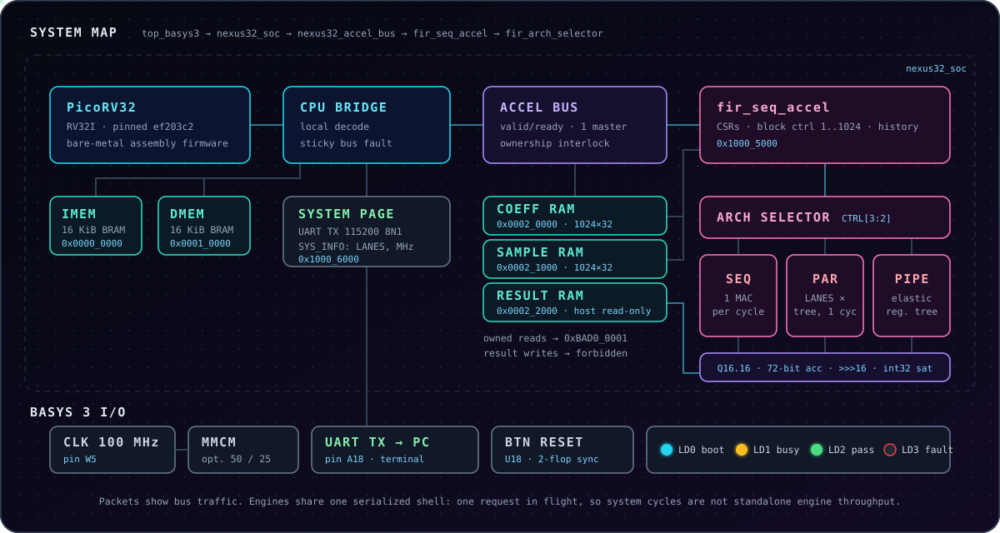

<p align="center">
  
</p>

<p align="center">
  <a href="https://github.com/Aneeshparveda/NEXUS-32/actions/workflows/nexus32-ci.yml"></a>
  
  
  
  
  
  <a href="LICENSE"></a>
</p>

<p align="center">
  <b>Three ways to compute the same FIR filter. One numerical contract. No hand-waving.</b><br>
  <sub>Every number on this page is simulation evidence, Vivado output or a board measurement, and is labelled as such. Live status: <a href="docs/STATUS.md">docs/STATUS.md</a></sub>
</p>

<p align="center">
  <a href="#-boot-sequence">Boot</a> ·
  <a href="#-system-map">System map</a> ·
  <a href="#-the-three-engines">Engines</a> ·
  <a href="#-engine-race">Race</a> ·
  <a href="#-evidence-ledger">Evidence</a> ·
  <a href="#-run-it">Run it</a> ·
  <a href="#-vivado-in-four-clicks">Vivado</a> ·
  <a href="#-deep-spec">Deep spec</a>
</p>

---

## ▸ Boot sequence

This is what NEXUS-32 prints when it boots. A PicoRV32 core loads a 1024-sample
block, runs it through all three FIR engines, checks every result against a
checksum computed by the Python golden model, and reports over UART:

```console
$ bash scripts/run_soc_demo.sh 8          # full SoC, RTL simulation, LANES=8

=== NEXUS-32 board demo (PicoRV32 + 3 FIR engines) ===
build: LANES=8 CLK_MHZ=100 TAP_COUNT=8 SAMPLE_COUNT=1024 golden_checksum=0xb2be7f16
arch=SEQ     check=PASS cycles_total=14352 compute_cycles=14332 result_count=1024 checksum=0xb2be7f16 status=0x00000002
arch=PAR     check=PASS cycles_total=5136 compute_cycles=5116 result_count=1024 checksum=0xb2be7f16 status=0x00000002
arch=PIPE    check=PASS cycles_total=9232 compute_cycles=9212 result_count=1024 checksum=0xb2be7f16 status=0x00000002
NEXUS32 RESULT: PASS
```

On a Basys 3 the same firmware prints this to a PC terminal and lights
**LD0** (booted) and **LD2** (all engines pass). On 2026-11-13 a real Basys 3
(LANES=8, 50 MHz) printed exactly these cycle counts and `NEXUS32 RESULT: PASS`
([board evidence](results/board_2026-11-13/MANIFEST.md)). The transcript above
comes from simulation, decoded bit by bit from the simulated UART pin.

## ▸ Why this exists

Most accelerator demos show one architecture and one number. NEXUS-32 asks a
harder question: **with the same numerical contract, the same SoC, the same
memory and the same test vectors, how do a sequential, a parallel and a
pipelined FIR engine really differ?**

- **One contract.** Signed Q16.16 inputs, exact 32×32→64-bit products, a
  72-bit Q40.32 accumulator, no intermediate rounding, then one `>>> 16` and
  an int32 clamp. All three engines and the Python model agree bit for bit.
- **One runtime switch.** `CTRL.ARCH_SEL` picks the engine per run. Invalid
  requests become error responses, never silent garbage.
- **Evidence discipline.** Claims are tied to a named test, a command and a
  receipt. Simulation is never presented as silicon.

## ▸ System map

<p align="center">
  
</p>

| Layer | Module | What it does |
|---|---|---|
| Board | `rtl/top_basys3.sv` | 100 MHz clock (optional MMCM to 50/25 MHz), synchronized reset button, 4 status LEDs, UART TX on pin A18 |
| SoC | `rtl/nexus32_soc.sv` | PicoRV32 (pinned `ef203c2`), 16 KiB IMEM + 16 KiB DMEM in block RAM, CPU bridge, system page (UART, `SYS_INFO`) |
| Bus | `rtl/nexus32_accel_bus.sv` | Single-master valid/ready adapter, memory-ownership interlock, result RAM |
| Shell | `rtl/fir_seq_accel.sv` | CSRs, serialized block controller (1..1024 samples), zero-initialised history, debug events |
| Engines | `rtl/fir_arch_selector.sv` + three engines | Runtime selection; one request in flight |
| Model | `golden_model/fir_q16.py` | Executable bit-exact reference |

## ▸ The three engines

| | **SEQUENTIAL** | **PARALLEL** | **PIPELINED** |
|---|---|---|---|
| Source | `fir_seq_engine.sv` | `fir_parallel_engine.sv` | `fir_pipelined_engine.sv` |
| Idea | One 32×32 MAC per tap, ordered tap reads | `LANES` multipliers + balanced 72-bit adder tree | Registered products + `log2(LANES)` registered tree levels |
| Result | After `TAP_COUNT` MACs | One cycle after accept | Visible `log2(LANES)+1` cycles after accept (3/4/5/6) |
| Standalone throughput | ≈ 1 output per `TAP_COUNT` cycles | 1 per cycle | 1 per cycle after fill, elastic under backpressure |
| Hardware scales with | constant (1 multiplier) | `LANES` | `LANES`, plus pipeline registers |
| Parameter | taps 1..32 | `LANES` ∈ {4, 8, 16, 32} | `LANES` ∈ {4, 8, 16, 32} |

## ▸ Engine race

<p align="center">
  
</p>

Full sweep: demo firmware through PicoRV32, `TAP_COUNT = LANES`, 1024 samples,
`CYCLES_TOTAL` from the accelerator's own counter. Every run matches the golden checksum.

| LANES = taps | Sequential | Parallel | Pipelined |
|---:|---:|---:|---:|
| 4 | 10 248 | **5 128** | 8 200 |
| 8 | 14 352 | **5 136** | 9 232 |
| 16 | 22 560 | **5 152** | 10 272 |
| 32 | 38 976 | **5 184** | 11 328 |

> [!IMPORTANT]
> **Read this caveat with the numbers.** The integrated shell serializes one request in flight, so these are
> **system** cycle counts, not standalone engine throughput, MHz, LUTs or power. That is why the pipelined
> engine trails the parallel one here, even though it sustains one result per cycle on its own (measured in
> `tests/rtl/tb_fir_pipelined_latency.sv`). Lifting the serialization is on the roadmap. FPGA area and
> timing come from Vivado: see the evidence ledger below.

## ▸ Evidence ledger

| Layer | State | Proof |
|---|:---:|---|
| Golden model | **VERIFIED** | 34 Python unit tests (`python3 -m unittest discover -s tests`) |
| Engines vs model | **VERIFIED** | 3-way differential, 78/79/79/78 cases at LANES 4/8/16/32; 1 034-vector golden regression, 0 mismatches |
| Block controller | **VERIFIED** | Verification closure **15 PASS / 0 FAIL**: 1024-sample scoreboards, partial faults, reset races ([receipt](docs/VERIFICATION_CLOSURE.md)) |
| SoC through the CPU | **VERIFIED** | Smoke, multi-arch, fault paths, sub-word, protected access, 1024-sample block, START→verdict latency 129 cycles |
| Board demo + UART | **VERIFIED in simulation** | `tb_nexus32_soc_demo` decodes the UART independently at LANES 4/8/16/32 |
| Continuous integration | **VERIFIED** | GitHub Actions, 25 named steps, every push to `main` and every PR |
| Vivado synthesis, timing, utilization | **MEASURED** | LANES=8 @ 50 MHz: timing met (WNS +0.468 ns, WHS +0.014 ns), 4695 LUT, 68/90 DSP, 13 BRAM; 100 MHz misses timing ([manifest](results/board_2026-11-13/MANIFEST.md)) |
| Silicon (Basys 3 LEDs + UART log) | **VERIFIED on board** | LD0/LD2 on, LD3 off; UART `NEXUS32 RESULT: PASS`, 82/82 reports, cycles identical to simulation; die 33.3 °C ([log](results/board_2026-11-13/uart_log.txt)) |
| Accelerator vs CPU alone | **MEASURED in simulation** | Plain C on the PicoRV32 (no multiplier): 13.3 M cycles at 8 taps; the engines are 926×–2 587× faster ([baseline](experiments/sw_baseline/README.md)) |

## ▸ Run it

Prerequisites: Bash, GNU Make, Python 3.12, Git, `tclsh`, Icarus Verilog,
Verilator, and a RISC-V toolchain (`riscv64-elf-*` or `riscv64-unknown-elf-*`).

```bash
make setup        # once, networked: pinned PicoRV32 + firmware images
make test         # the offline regression gate (what CI runs)
make soc-demo     # watch the board demo print through a simulated UART
```

Prefer containers? The Docker image runs the same gate:

```bash
docker build -t nexus32:ubuntu-24.04 . && docker run --rm nexus32:ubuntu-24.04
```

## ▸ Vivado in four clicks

Vivado runs on a Windows laptop, with no bash, toolchain or network needed.
On the dev machine, `bash scripts/make_vivado_bundle.sh` packs everything into
one zip. Unzip it to `C:\nexus32`, then from `C:\nexus32\vivado\`:

| Click | Script | Result |
|:---:|---|---|
| 1 | `RUN_ALL.bat` | Builds LANES=4 and 8 to bitstream, retries at 50 MHz if timing fails, sweeps every engine, writes `EVIDENCE.md` |
| 2 | `PROGRAM_BOARD.bat` | Programs the best build that met timing |
| 3 | `READ_UART.bat` | Saves the board's own report |
| 4 | `COLLECT_EVIDENCE.bat` | `nexus32-evidence.zip`: every number, copied from tool-written files |

Full runbook and failure guide: [docs/VIVADO_DAY.md](docs/VIVADO_DAY.md).

## ▸ Repository map

```text
golden_model/   bit-exact Python reference
rtl/            engines, selector, accelerator shell, bus, UART, SoC, Basys 3 top
firmware/       bare-metal RV32I assembly: board demo, smoke and fault-path programs
tests/          Python tests and directed RTL / SoC testbenches
scripts/        simulation runners, firmware builds, golden constants, Vivado bundle
vivado/         board + characterization Tcl flows, Windows one-click launchers
constraints/    Basys 3 pin constraints (XDC)
docs/           contract, status, verification receipts, Vivado runbook
assets/         the visuals on this page
```

## ▸ Deep spec

<details>
<summary><b>Memory map</b></summary>

| Region | Address range | Role |
|---|---:|---|
| Instruction BRAM | `0x0000_0000–0x0000_3FFF` | PicoRV32 instruction reads (also data-readable for constants) |
| Data BRAM | `0x0001_0000–0x0001_3FFF` | PicoRV32 data reads/writes, byte strobes |
| Coefficient BRAM | `0x0002_0000–0x0002_0FFF` | Host R/W while idle; accelerator source while owned |
| Sample BRAM | `0x0002_1000–0x0002_1FFF` | Host R/W while idle; accelerator source while owned |
| Result BRAM | `0x0002_2000–0x0002_2FFF` | Host read-only; accelerator result destination |
| Accelerator CSRs | `0x1000_5000–0x1000_5FFF` | Control, status, counters, debug registers |
| System page | `0x1000_6000–0x1000_6FFF` | `0x00` UART_TXDATA (W), `0x04` UART_STATUS (TX_READY, sticky TX_OVERRUN), `0x08` SYS_INFO (`0x4E58`, CLK_MHZ, LANES) |

Diagnostics (these do not by themselves set accelerator `STATUS.ERROR`):
- unmapped pages → `BUS_UNMAPPED`, data `0xDEAD_BEEF`;
- mapped but malformed or reserved accesses → `BUS_ACCESS`, zero data;
- result writes → `RESULT_WRITE_FORBIDDEN`, zero data;
- reads of owned memory → `MEM_OWNERSHIP`, data `0xBAD0_0001`;
- owned coefficient/sample writes → `MEM_OWNERSHIP`, zero data, no BRAM side effect.

All of these return `rsp_error=1`.

</details>

<details>
<summary><b>Accelerator CSRs</b> (offsets from <code>0x1000_5000</code>; normative contract: <a href="docs/ACCELERATOR_CONTRACT_V1.md">ACCELERATOR_CONTRACT_V1.md</a>)</summary>

| Offset | Register | Meaning |
|---:|---|---|
| `0x00` | `CTRL` | `START` bit 0, `RESET` bit 1, `ARCH_SEL` bits 3:2 (00 SEQ, 01 PAR, 10 PIPE, 11 rejected); RESET wins |
| `0x04` | `STATUS` | `BUSY`, sticky `DONE`, sticky `ERROR` (W1C while idle) |
| `0x08` | `TAP_COUNT` | 1..LANES, validated at START |
| `0x0C` / `0x10` / `0x14` | `COEFF_PTR` / `INPUT_PTR` / `OUTPUT_PTR` | Byte pointers into the three banks |
| `0x18` | `CYCLES_TOTAL` | START through final commit (or internal-fault termination) |
| `0x1C` | `SAMPLE_COUNT` | Block length 1..1024, snapshotted on START |
| `0x20` | `COMPUTE_CYCLES` | First input transfer to last output transfer |
| `0x24` / `0x28` / `0x2C` | `AUTO_*` | Reserved: reads zero, writes rejected |
| `0x30` / `0x34` / `0x38` | `DBG_STATUS` / `DBG_ADDR` / `DBG_INFO` | Sticky debug events, address, metadata |
| `0x3C` | `RESULT_COUNT` | Successful result commits only |
| `0x40` / `0x44` | `CONTRACT_VERSION` / `BUILD_ID` | Reserved: reads zero, writes rejected |

Debug bits 0–7: `BUS_UNMAPPED`, `BUS_ACCESS`, `MEM_OWNERSHIP`, `RESULT_WRITE_FORBIDDEN`, `CONFIG_WHILE_BUSY`, `INVALID_CONFIG`, `BRAM_FAULT`, `ENGINE_ERROR`. Same-edge priority: `ENGINE_ERROR > BRAM_FAULT > INVALID_CONFIG > RESULT_WRITE_FORBIDDEN > MEM_OWNERSHIP > CONFIG_WHILE_BUSY > BUS_UNMAPPED > BUS_ACCESS`.

</details>

<details>
<summary><b>Basys 3 pins and board build</b></summary>

`rtl/top_basys3.sv` targets Basys 3 rev-B (`xc7a35tcpg236-1`), default `LANES=8`, `SYS_CLK_MHZ=100`
(50/25 through an MMCM), demo firmware in IMEM. Pins from `constraints/basys3.xdc`: clock `W5`,
reset button `U18`, LEDs `U16` `E19` `U19` `V19` (boot, busy, pass, fault), UART TX `A18`, all `LVCMOS33`.
The LEDs report architectural events, not a heartbeat, so a stopped board stays diagnostic.

```bash
python3 scripts/check_basys3_constraints.py      # wrapper and XDC agree, no Vivado needed
vivado -mode batch -source vivado/build_basys3.tcl -tclargs results/vivado/basys3_l8 8 [50]
```

Each build writes `build_summary.md`, `metrics.txt` (WNS/TNS/WHS/THS, LUT/FF/DSP/BRAM, `TIMING_MET`,
IMEM check), reports and the bitstream. A post-synthesis guard fails the flow if the firmware did not land
in IMEM. LANES 16/32 exceed the 90 DSP48E1 slices with all three engines built (confirmed by the
out-of-context core sweep). See [vivado/README.md](vivado/README.md).

</details>

<details>
<summary><b>Every verification command</b></summary>

```bash
make test                                  # offline gate: everything below that has no network need
make test-all                              # + fault-data, golden, soc-block-1024, subword (below)
python3 -m unittest discover -s tests -v
bash scripts/run_rtl_smoke.sh
bash scripts/run_differential_smoke.sh all
bash scripts/run_soc_smoke.sh all
bash scripts/run_soc_demo.sh all           # UART unit test + board demo, LANES 4/8/16/32
bash scripts/run_verification_closure.sh   # 15 required tests
bash scripts/test_basys3_flow_stub.sh      # Vivado flow logic, no Vivado
bash scripts/test_evidence_tools.sh        # Windows evidence tools, offline
make verilator                             # lint, gated by scripts/lint_baseline.txt
make golden                                # Python model vs all three engines, 1034 vectors
make soc-block-1024                        # CPU-driven 1024-sample block + 5 negative modes
make subword                               # CPU-driven SB/SH/LB/LH/LBU/LHU
# manual runner (run after touching its path)
bash scripts/run_protected_access_smoke.sh all
```

Passing CI is simulation and toolchain evidence only. It is not synthesis, timing closure,
a bitstream, board programming or physical validation.

</details>

<details>
<summary><b>Known limitations (deliberate, documented)</b></summary>

- The integrated shell is single-buffered and serializes one outstanding operation. Ping-pong memory, DMA,
  streaming interfaces and an adaptive (Auto) policy are out of scope for V1.
- Selector/SoC cycle counts include shell and serialization overhead; never present them as standalone
  engine throughput or PPA.
- The system page is transmit-only UART plus `SYS_INFO`. UART receive, GPIO, timers, interrupts and a debug
  monitor are out of scope. PicoRV32 is built without its IRQ controller.
- The pipelined engine's nominal `cycles_o` (`DEPTH+1`) and its measured transfer-edge latency are
  intentionally distinct.

</details>

## ▸ Mission timeline

- [x] Three engines under one Q16.16 contract, bit-exact Python golden model
- [x] Serialized block controller (1..1024 samples), CSR shell, memory-ownership interlock
- [x] Differential + SoC benches, verification closure 15/15, CI
- [x] Basys 3 integration, self-reporting UART demo, one-click Windows Vivado evidence flow
- [x] **First Vivado run:** utilization, timing, bitstream for LANES 4 and 8 (50 MHz met; 100 MHz misses)
- [x] **First silicon:** Basys 3, LEDs, UART `NEXUS32 RESULT: PASS`, dated photos (2026-11-13)
- [ ] Data-driven upgrades: pipeline the sequential engine's multiply-accumulate (the 50 MHz critical path) for 100 MHz, a streaming shell so the race shows true engine throughput
- [ ] v1.0.0 release with real Vivado numbers and per-architecture bitstreams
- [ ] Beyond: UART command channel, C firmware, formal properties, power analysis

## ▸ Credits

Built by **Aneesh Parveda** (sole technical and system owner), with Vivado/timing/bring-up support from
Manish and DV/regression/CI/firmware/toolchain support from Chakshu. CPU:
[PicoRV32](https://github.com/YosysHQ/picorv32), pinned and credited, provisioned at setup rather than
redistributed ([THIRD-PARTY-NOTICES.md](THIRD-PARTY-NOTICES.md)).

[Contributing](CONTRIBUTING.md) ·
[Security](SECURITY.md) ·
[Code of conduct](CODE_OF_CONDUCT.md) ·
[Accessibility](ACCESSIBILITY.md) ·
[Cite](CITATION.cff) ·
[MIT licence](LICENSE)

<p align="center"><sub>Simulation-proven today. Silicon is next, and this page will say so when it happens, with the receipts.</sub></p>
