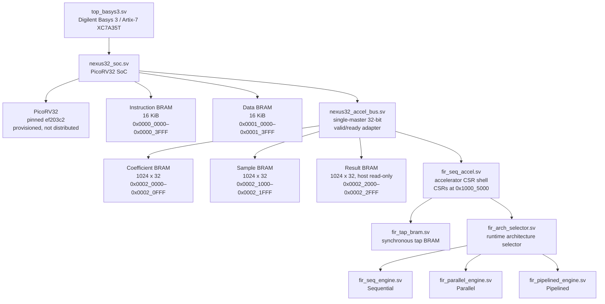
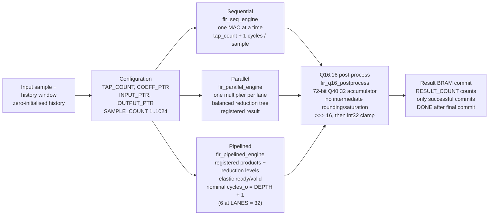
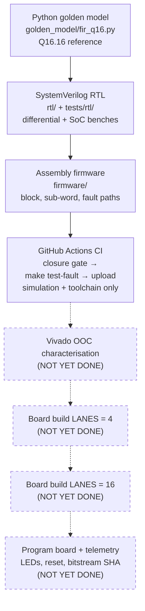

[](https://github.com/Aneeshparveda/NEXUS-32/actions)
[](LICENSE)


> **Status — read this first:** Simulation + CI verified
> (remote HEAD 868ef6b, CI run #7, all 23 steps). Vivado synthesis,
> timing, bitstream, and physical Basys 3 board validation are
> **not yet claimed** — they are the laptop-day / board phase, not
> done yet. SoC latency of **129 cycles is a LANES=32 simulation
> latency only** (START-to-verdict), not a board measurement and
> not `CYCLES_TOTAL`. No LUT / DSP / WNS numbers are claimed in
> this README, because no Vivado run has produced them yet.

## Contents

- [Target and architecture](#target-and-architecture)
- [Current block-processing status](#current-block-processing-status)
- [Numerical contract](#numerical-contract)
- [Architecture diagrams](#architecture-diagrams)
- [Simulation results (only)](#simulation-results-only)
- [SoC memory map](#soc-memory-map)
- [Accelerator CSR interface](#accelerator-csr-interface)
- [Known implementation limitations](#known-implementation-limitations)
- [Repository layout](#repository-layout)
- [Reproducible setup and offline test](#reproducible-setup-and-offline-test)
- [Docker reproducibility](#docker-reproducibility)
- [Basys 3 integration and FPGA build](#basys-3-integration-and-fpga-build)
- [FPGA deployment and physical validation](#fpga-deployment-and-physical-validation)
- [Verification commands](#verification-commands)
- [GitHub Actions CI](#github-actions-ci)
- [FPGA validation status](#fpga-validation-status)

# NEXUS-32 — PicoRV32 FIR SoC

NEXUS-32 is a PicoRV32-based SoC and a controlled comparison of three direct-form FIR architectures:

- an ordered, one-MAC-at-a-time sequential engine;
- a parallel engine with one multiplier per physical lane and a balanced reduction tree; and
- an elastic registered pipelined reduction tree.

The current integrated design is a simulation-verified, serialized block-processing controller and accelerator shell for a Basys 3 / Artix-7 target. It supports the configured block-length range `1..1024`, zero-initialized FIR history, independent sample and successful-commit counts, and physical result-memory commits. It has not yet been FPGA-validated. The normative accelerator behavior is specified in [`docs/ACCELERATOR_CONTRACT_V1.md`](docs/ACCELERATOR_CONTRACT_V1.md).

## Target and architecture

The intended FPGA target is the Digilent Basys 3 using an Artix-7 `XC7A35T-1CPG236C`, represented in the project flow as `xc7a35tcpg236-1`.

The current RTL path is:

```text
PicoRV32
  ├── 16 KiB instruction BRAM (`nexus32_soc`)
  ├── 16 KiB data BRAM (`nexus32_soc`)
  └── accelerator bus bridge (`nexus32_accel_bus`)
        ├── coefficient/sample host ports and result RAM
        └── accelerator CSR shell (`fir_seq_accel`)
              ├── synchronous tap BRAM (`fir_tap_bram`)
              └── runtime selector (`fir_arch_selector`)
                    ├── sequential (`fir_seq_engine`)
                    ├── parallel (`fir_parallel_engine`)
                    └── pipelined (`fir_pipelined_engine`)
```

`LANES` is supported at 4, 8, 16, or 32; the integrated shell defaults to 32. The selector and wrapper serialize the integrated shell to one outstanding operation, so selector/SoC results are functional block-processing results, not standalone throughput or PPA measurements. The direct pipelined engine retains its own ready/valid throughput behavior, but that throughput is not exposed as the serialized shell's top-level throughput.

The integrated shell is a single-buffer block controller. After an accepted START snapshots the configuration, it captures one sample at a time, forms a stable window from the pending sample and accepted-input history, dispatches one engine operation, and waits for the corresponding physical result-memory commit before advancing. `SAMPLE_COUNT` is the configured block length and `RESULT_COUNT` counts only successful commits; `DONE` is asserted after the final commit. Accepted `CTRL.RESET` cancels pending controller state and prevents a pending physical result write, but does not clear BRAM contents. Sample B/ping-pong memory, DMA, streaming interfaces, and AutoArch policy are not implemented in this repository state.

## Current block-processing status

The serialized controller now implements the core multi-sample path described by the contract:

- active tap count, pointers, and block length are snapshotted on START;
- history starts at zero for each run and advances only when an engine input transfer is accepted;
- pending windows remain stable while the engine is not ready;
- output transfer and physical result commit are separate events;
- `RESULT_COUNT` advances only after a successful physical commit;
- a successful block satisfies `BUSY=0`, `DONE=1`, `ERROR=0`, and `RESULT_COUNT=SAMPLE_COUNT`; and
- internal faults leave earlier commits physically present but invalidate the block until RESET.

The detailed 1024-sample matrix, partial-fault checks, and measured pipeline latency are recorded in [`docs/VERIFICATION_CLOSURE.md`](docs/VERIFICATION_CLOSURE.md). This is simulation evidence for the current serialized implementation, not a claim that every V1.0 contract or milestone checklist item is complete.

## Numerical contract

Samples and coefficients are signed 32-bit Q16.16 integers. The RTL makes the arithmetic widths explicit:

1. signed 32×32 multiplication produces a signed 64-bit product;
2. each product is sign-extended to a signed 72-bit Q40.32 term;
3. accumulation and reduction-tree additions remain signed 72-bit;
4. there is no intermediate rounding or saturation;
5. the completed accumulator is shifted arithmetically by 16 (`>>> 16`); and
6. the shifted value is saturated to signed 32-bit range.

The saturation limits are `0x7fffffff` and `0x80000000`. Arithmetic right shift gives the documented floor-toward-negative-infinity behavior for negative values. The reusable arithmetic primitives are `rtl/fir_q16_mac.sv` and `rtl/fir_q16_postprocess.sv`; the executable Python reference is under `golden_model/`.

### Engine behavior

- **Sequential:** `rtl/fir_seq_engine.sv` issues ordered tap requests, accepts ordered valid responses including response bubbles, performs one MAC per valid tap, and reports busy/source-wait cycles through its nominal `cycles_o` counter. It does not provide request backpressure.
- **Parallel:** `rtl/fir_parallel_engine.sv` captures a vector, zero-gates inactive lanes, reduces the signed 72-bit products through a balanced tree, and registers the result. Ready/valid output backpressure holds the result stable.
- **Pipelined:** `rtl/fir_pipelined_engine.sv` registers products, reduction levels, and output processing with elastic ready/valid propagation. Its nominal `cycles_o` is `DEPTH + 1` (`6` at `LANES=32`), not elapsed latency under backpressure.
- **Selector:** `rtl/fir_arch_selector.sv` selects sequential, parallel, or pipelined operation at run time and returns ordered responses. Invalid architecture/tap requests become error responses.

## Architecture diagrams

Diagrams are rendered from the RTL structure and the planned flow.
Vivado and board parts are labelled not yet done where they appear.

### SoC block diagram

> **What is still unverified in this diagram:** the Basys 3 wrapper,
> pin constraints, and Vivado build flow are source-integrated, but
> Vivado synthesis, timing, bitstream, and board programming have NOT
> been run. The diagram shows the intended target and the RTL
> structure, not a validated board design.



### FIR accelerator comparison

> **What is still unverified in this diagram:** engine cycle counts
> below are from simulation / engine definitions, not from board
> measurements. The integrated shell serializes to one outstanding
> operation, so SoC-level results are functional block-processing
> results, NOT standalone throughput or PPA measurements. Do not
> present this diagram as a throughput or PPA comparison.



### Repository and verification workflow

> **What is still unverified in this diagram:** everything in a dashed
> box is NOT YET DONE. Do not render those boxes as solid, and do not
> remove the "not yet done" label — the dashed style IS the honesty
> mechanism. If GitHub's Mermaid renderer does not support the dashed
> class in this exact form, replace the class with the text
> "(NOT YET DONE)" in the box label and keep the label.



## SoC memory map

The accelerator-facing map is defined by the V1.0 contract:

| Region | Address range | Current role |
|---|---:|---|
| Instruction BRAM | `0x0000_0000–0x0000_3FFF` | PicoRV32 instruction reads |
| Data BRAM | `0x0001_0000–0x0001_3FFF` | PicoRV32 data reads/writes |
| Coefficient BRAM | `0x0002_0000–0x0002_0FFF` | Host read/write while idle; accelerator source while owned |
| Sample BRAM | `0x0002_1000–0x0002_1FFF` | Host read/write while idle; accelerator source while owned |
| Result BRAM | `0x0002_2000–0x0002_2FFF` | Host read-only; accelerator result destination |
| Accelerator CSRs | `0x1000_5000–0x1000_5FFF` | Control, status, counters, and debug registers |

`rtl/nexus32_accel_bus.sv` is a single-master 32-bit valid/ready adapter. Requests are accepted on `req_valid_i && req_ready_o`; while stalled, request fields must remain stable. Each accepted request receives one one-cycle response pulse and there is no response-ready signal.

Accelerator memory and CSR transfers must be aligned 32-bit accesses. Partial writes are rejected. The implemented diagnostic behavior is:

- unmapped pages: `BUS_UNMAPPED`, response data `0xDEAD_BEEF`, `rsp_error=1`;
- mapped malformed/reserved accesses: `BUS_ACCESS`, zero response data, `rsp_error=1`;
- result-memory writes: `RESULT_WRITE_FORBIDDEN`, zero response data, `rsp_error=1`;
- reads of owned coefficient/sample/result memory: `MEM_OWNERSHIP`, response data `0xBAD0_0001`, `rsp_error=1`; and
- owned coefficient/sample writes: `MEM_OWNERSHIP`, zero response data, `rsp_error=1`, with no BRAM side effect.

Host transaction errors are diagnostic events and do not by themselves set accelerator `STATUS.ERROR` or invalidate an otherwise valid run. `bus_fault_sticky_o` and the SoC-level `cpu_bus_fault_o` are external sticky diagnostics cleared only by hardware reset. The CPU bridge preserves diagnostic response data such as `0xBAD0_0001` while completing the CPU handshake.

## Accelerator CSR interface

CSR addresses below are byte offsets from `0x1000_5000`. `CTRL` and `STATUS` use complete-word accesses; `STATUS` and `DBG_STATUS` W1C operations are permitted only while idle according to the contract.

| Offset | Register | Contract meaning | Current implementation note |
|---:|---|---|---|
| `0x00` | `CTRL` | `START` bit 0, `RESET` bit 1, `ARCH_SEL` bits 3:2; RESET wins | Implemented; START while BUSY is a normal no-op |
| `0x04` | `STATUS` | `BUSY`, sticky `DONE`, sticky `ERROR` | Implemented with idle W1C recovery rules |
| `0x08` | `TAP_COUNT` | Configured tap count, validated against the selected build | Implemented |
| `0x0C` | `COEFF_PTR` | Coefficient byte pointer | Implemented |
| `0x10` | `INPUT_PTR` | Input byte pointer | Implemented as the source of the serialized sample block |
| `0x14` | `OUTPUT_PTR` | Result byte pointer | Implemented as the base for per-sample physical commits |
| `0x18` | `CYCLES_TOTAL` | Run-level timing counter | Implemented from START through final commit, or through internal-fault termination |
| `0x1C` | `SAMPLE_COUNT` | Contract: configured block length, `1..1024` | Implemented as an independent configured length and snapshotted on START |
| `0x20` | `COMPUTE_CYCLES` | Contract: first input-transfer to last output-transfer span | Implemented and checked with an independent transfer-edge scoreboard |
| `0x24` | `AUTO_CFG` | Reserved/deferred | Reads return zero; writes are rejected |
| `0x28` | `AUTO_SELECTED` | Reserved/deferred | Reads return zero; writes are rejected |
| `0x2C` | `AUTO_MODEL_ID` | Reserved/deferred | Reads return zero; writes are rejected |
| `0x30` | `DBG_STATUS` | Sticky debug event bits | Bits 0–5 are idle W1C; bits 6–7 are RESET-only |
| `0x34` | `DBG_ADDR` | Address for the latest selected debug event | Implemented with fixed event priority and tie-breaking |
| `0x38` | `DBG_INFO` | Event, direction, and master metadata | Implemented |
| `0x3C` | `RESULT_COUNT` | Contract: successful result-memory commits | Implemented as an independent successful physical-commit counter |
| `0x40` | `CONTRACT_VERSION` | Reserved/deferred | Reads return zero; writes are rejected |
| `0x44` | `BUILD_ID` | Reserved/deferred | Reads return zero; writes are rejected |

The debug event bits are `BUS_UNMAPPED`, `BUS_ACCESS`, `MEM_OWNERSHIP`, `RESULT_WRITE_FORBIDDEN`, `CONFIG_WHILE_BUSY`, `INVALID_CONFIG`, `BRAM_FAULT`, and `ENGINE_ERROR` at bits 0 through 7. When multiple events occur on one edge, all applicable sticky bits are set and metadata follows the contract priority:

```text
ENGINE_ERROR > BRAM_FAULT > INVALID_CONFIG > RESULT_WRITE_FORBIDDEN
> MEM_OWNERSHIP > CONFIG_WHILE_BUSY > BUS_UNMAPPED > BUS_ACCESS
```

For a same-class tie, the lowest address wins, then writes beat reads, then the lowest master ID wins. The CPU/Port-A master ID is 0.

## Known implementation limitations

These remain deliberate, documented limitations; the closure above is not a claim of completed V1.0 hardware validation or of every contract checklist item:

- The integrated wrapper is single-buffered and serializes one outstanding operation. Sample B/ping-pong memory, DMA, streaming interfaces, and AutoArch policy are outside the current implementation.
- The direct pipelined engine's no-stall transfer-edge latency is measured in the closure report; its nominal `cycles_o` field and the measured transfer latency are intentionally distinct. Backpressure stability is checked, but stalled elapsed latency is not a standalone performance claim.
- Selector/SoC measurements include wrapper and serialization overhead and must not be presented as standalone architecture throughput or PPA results.
- UART/GPIO/timer/IRQ/debug-monitor integration and a full SoC bus fabric remain outside the current implementation.
- The Basys 3 wrapper, official pin constraints, and integrated Vivado build flow are source-integrated, but Vivado synthesis, timing closure, PPA/resource analysis, bitstream validation, board programming, and physical Basys 3 validation have not been completed in this environment.

## Repository layout

```text
golden_model/   Bit-exact Python reference model
rtl/            FIR engines, BRAM, accelerator shell, bus adapter, and SoC
constraints/    Board-specific XDC constraints
firmware/       Bare-metal RV32I assembly and linker/image sources
tests/          Python reference tests and directed RTL/SoC testbenches
scripts/        Firmware, vendor-source, simulation, and characterization flows
vendor/         Pinned PicoRV32 source after provisioning
Makefile        Canonical offline test gate and networked setup target
Dockerfile      Ubuntu 24.04 reproducibility image definition
results/        Generated simulation outputs; do not commit large build artifacts
build/          Generated firmware/build outputs
docs/           Contract, integration notes, status, and provenance
```

The PicoRV32 provisioning script pins upstream revision `ef203c2b0a3fb793280f5114941416c425c5b461`; see [`docs/PICORV32_PIN.md`](docs/PICORV32_PIN.md).

## Reproducible setup and offline test

The Python runtime marker is `.python-version` (`3.12.3`). The Python reference
model and utility scripts use only the standard library; `requirements.txt` is
the empty dependency manifest and `requirements.lock` records that there are
no third-party packages to install.

For a host installation, provide Bash, GNU Make, Python 3.12.3, Git, Tcl
(`tclsh`), Icarus Verilog (`iverilog` and `vvp`), Verilator, `file`, and one
complete RISC-V RV32I toolchain pair. The Makefile selects `riscv64-elf-gcc` with
`riscv64-elf-objcopy` first, then `riscv64-unknown-elf-gcc` with
`riscv64-unknown-elf-objcopy`. `RISCV_CC` and `RISCV_OBJCOPY` can be set to
explicit executable names or paths when a toolchain is installed elsewhere.

Run setup once from the repository root on a networked machine:

```bash
make setup
```

`make setup` runs the pinned PicoRV32 provisioning script and prepares the
smoke, multi-architecture, and invalid-fetch firmware images. The checkout is
verified against revision
`ef203c2b0a3fb793280f5114941416c425c5b461`. It is the only project target
that performs the network-dependent provisioning step.

After setup, the canonical regression is offline and does not invoke the
vendor script:

```bash
make test
```

Before running any checks, `make test` requires
`vendor/picorv32/picorv32.v`, its matching `REVISION.txt`, and
`firmware/nexus32_smoke.hex`. If the pinned vendor source is absent or
unverified, it fails with a message directing you to `make setup` instead of
silently skipping the SoC checks. The gate then runs, in order, the `Makefile:32` `test` targets `status-property, check-prerequisites, python-tests, toolchain, rtl, differential, soc, soc-latency, basys3, vivado-flow-stub, provenance-test, verilator, verification-closure`.
The flow stub verifies that the success path creates the expected summaries
and that an injected mandatory-stage failure returns exit code 1 while
skipping later stages; it does not replace Vivado synthesis or timing
analysis.

The individual underlying commands remain available for focused debugging:

```bash
python3 -m unittest discover -s tests -v
bash scripts/check_toolchain.sh
bash scripts/run_rtl_smoke.sh
bash scripts/run_differential_smoke.sh all
bash scripts/run_soc_smoke.sh all
python3 scripts/check_basys3_constraints.py
bash scripts/test_basys3_flow_stub.sh
bash scripts/run_verification_closure.sh
```

## Docker reproducibility

`Dockerfile` is based on Ubuntu 24.04 and installs the simulator, Verilator,
RISC-V compiler/binutils, Python, Git, Make, and required command-line tools
inside the image. The image build runs `make setup`, so the build needs network
access for the pinned PicoRV32 checkout. Once built, the default container
command is the offline regression:

```bash
docker build -t nexus32:ubuntu-24.04 .
docker run --rm nexus32:ubuntu-24.04
```

To pass the command explicitly, use:

```bash
docker run --rm nexus32:ubuntu-24.04 make test
```

Generated host build/results directories, generated firmware images, and any
local vendored checkout are excluded by `.dockerignore`; the image recreates
them through `make setup`.

## Basys 3 integration and FPGA build

The board-level candidate is `rtl/top_basys3.sv`, targeting the Digilent Basys
3 rev-B board (`xc7a35tcpg236-1`) with `LANES=16` by default. It connects the
100 MHz oscillator, center pushbutton, and four status LEDs. The LEDs report
firmware boot, accelerator busy, accelerator completion/firmware pass, and
trap or sticky-fault status; they are not a free-running heartbeat. The center
button is active-high and is converted to the SoC's active-high synchronous
reset with asynchronous assertion and two-clock synchronized release.

The official Digilent Basys-3 master XDC is represented by
`constraints/basys3.xdc`: clock `W5`, center button `U18`, and LEDs `U16`,
`E19`, `U19`, and `V19`, all using `LVCMOS33`. Check the wrapper/XDC port
consistency without Vivado with:

```bash
python3 scripts/check_basys3_constraints.py
```

The deterministic integrated Vivado flow builds the existing smoke firmware,
uses the pinned PicoRV32 source, loads the generated instruction image through
the SoC's synthesizable `$readmemh` initialization, and runs synthesis,
implementation, reports, and bitstream generation:

```bash
vivado -mode batch -nojournal -nolog \
  -source vivado/build_basys3.tcl \
  -tclargs results/vivado/basys3 16
```

The first argument is an output directory and the second is the lane count
(`4`, `8`, `16`, or `32`). The flow selects `RISCV_CC` and `RISCV_OBJCOPY`
explicitly when set, otherwise it tries the `riscv64-elf-*` and then
`riscv64-unknown-elf-*` tool names. If the pinned PicoRV32 checkout is absent,
the flow invokes `scripts/vendor_picorv32.sh`; that provisioning step requires
network access. Build summaries and generated Vivado reports are written under
the ignored output directory, including `build_summary.tsv` and
`build_summary.md`. A successful exit requires all mandatory stages through
bitstream generation to pass. This command has not produced Vivado evidence on
the current machine because Vivado is not installed.

## FPGA deployment and physical validation

After a successful Vivado build, the bitstream is
`results/vivado/basys3/top_basys3.bit`. The deployment procedure is:

1. Connect and power a Digilent Basys 3 rev-B board over USB.
2. Open Vivado Hardware Manager, open the hardware target, and select the
   board's FPGA device.
3. Program the device with `top_basys3.bit`.
4. Release the center button. Confirm `led[0]` reports firmware boot,
   `led[2]` reports accelerator completion/firmware PASS, and `led[3]` stays
   low (no trap, bus fault, or accelerator error). `led[1]` may indicate the
   accelerator busy interval.
5. Record the programmed bitstream identity, observed LED behavior, board
   revision, and any failures alongside the Vivado reports.

Vivado, a Basys 3 board, and hardware-programming access are unavailable in
the current environment. Therefore the repository currently has no Vivado
synthesis, implementation/timing, bitstream-programming, or physical
validation result; `make test` establishes simulation and source-level checks
only. Perform the deployment steps above only after the integrated Vivado
flow completes successfully on a machine with the licensed tool and hardware.

## Simulation results (only)

Simulation evidence only — not throughput, not MHz, not LUT/DSP,
not board results. From `docs/VERIFICATION_CLOSURE.md` (receipt
2026-10-18, Icarus 13.0; 1024 samples, TAP_COUNT = 3), re-confirmed
by the Mac runs on this tree and by CI run #7 on 868ef6b.
The integrated shell serializes to one outstanding operation, so
these are functional block-processing cycle counts, not standalone
architecture throughput or PPA measurements. Pipelined cycles rise
with LANES because the serialized shell dominates — that caveat
travels with the table, do not drop it.

| LANES | Sequential CYCLES_TOTAL | Parallel CYCLES_TOTAL | Pipelined CYCLES_TOTAL |
|---:|---:|---:|---:|
| 4 | 9222 | 5126 | 8198 |
| 8 | 9222 | 5126 | 9222 |
| 16 | 9222 | 5126 | 10246 |
| 32 | 9222 | 5126 | 11270 |

SoC START-to-verdict latency, LANES = 32, simulation only: **129 cycles**
(START to verdict, verdict `0x600d600d`). This is NOT `CYCLES_TOTAL`
and NOT a board latency.

## Verification commands

These are the principal verification commands (not the full gate — see `Makefile:32`):

```bash
make test
python3 -m unittest discover -s tests -v
bash scripts/check_toolchain.sh
bash scripts/run_rtl_smoke.sh
bash scripts/run_differential_smoke.sh all
bash scripts/run_soc_smoke.sh all
python3 scripts/check_basys3_constraints.py
bash scripts/run_verification_closure.sh
```

It omits the status-property, soc-latency, and provenance-test gate steps, the Verilator lint step, `make test-fault`, and the manual runners listed below.

`make test` is the canonical offline entry point for the `make test` sequence (excluding `make test-fault` and the manual runners listed below);
its `differential` target runs the existing three-way FIR smoke script for
`LANES=4, 8, 16, 32`.
The Python command checks the signed Q16.16 reference behavior, saturation
boundaries, negative arithmetic shift behavior, tap-count validation, and
block-model cases. The RTL smoke command runs the arithmetic primitives,
sequential engine, synchronous source, tap BRAM, accelerator shell,
architecture integration, bus, SoC, invalid-fetch, backpressure, and
reset-recovery simulations when their prerequisites are present. The SoC
smoke command repeats the bus/SoC suites for `LANES=4, 8, 16, 32`. The
Makefile adds the Basys 3 XDC check and the same `--Wall --Wno-fatal`
Verilator lint configuration used by CI before invoking the verification
closure gate.

The verification-closure command is the canonical pure-RTL gate. It runs the independent 1024-sample block/timing scoreboard, direct pipelined-latency experiments, the block-processing acceptance suite for `LANES=4, 8, 16, 32` (the 75-cases-per-lane figure at `docs/VERIFICATION_CLOSURE.md:143` is reset-race coverage, not this suite), and the fixed-`LANES=32` block-configuration and configuration-stage acceptance benches. Its generated binaries, per-test status report and logs are written under ignored `results/verification-closure/`; the durable results summary and reproduction details are in [`docs/VERIFICATION_CLOSURE.md`](docs/VERIFICATION_CLOSURE.md). Missing mandatory tools or tests and any compile/simulation failure produce a nonzero gate exit.

### Targeted Wave A/B verification

The targeted regression runners added after the closure receipt fall into
two groups: gated commands, and manual runners that are not in any gate.
The grouping below overrides any reading of the previous listing that
implied all of these commands were gate members.

Gated commands in this group:

```bash
make test-fault
make test-all
```

`make test-fault` is a member of `make test-all` and of the CI job, but
not of `make test` itself.

> **Gate-membership note — 2026-10-25 (autonomous lab, working copy HEAD
> `db7cd79`).** No step of `make test`, `make test-all`, or
> `.github/workflows/nexus32-ci.yml` invokes the four manual runners
> below, so a failure in any of them does not cause `make test`,
> `make test-all`, or the CI job to fail. `make test` and CI are not the
> same gate: CI does not run `make test` or `make test-all`; it
> enumerates its own steps, so wiring a runner into a gate must be added
> to both the Makefile and CI to gate in both. Non-gating does not mean
> optional or skippable: a PASS here remains the only evidence for
> CPU-driven subword access, CPU-driven 1024-sample blocks,
> protected-access sweep behaviour, and Python-model-versus-engine
> agreement, and these runners must still be run after any RTL or
> firmware change touching those paths before the corresponding claim is
> made. Wiring decision deferred on 2026-10-25 for a stated reason: this
> environment has no simulator with which to sim-validate gate wiring,
> so wiring blind would itself be an unverified gate change. This note
> is disclosure only, not a decision not to wire. `run_golden_regression.py`,
> `run_subword_smoke.sh`, and `run_soc_block_1024.sh all` are wireable
> as-is as single steps (each builds its own firmware);
> `run_protected_access_smoke.sh all` is not wireable as a sweep without
> per-lane firmware work, since `LANES<32` fails preflight — and
> explicit `run_protected_access_smoke.sh 32` is wireable only after
> the script-label fix below, because `run_lane` still prints a
> "lane sweep" PASS line for a single lane.
> Exception: the *bench* `tb_nexus32_soc_protected_access` (not the sweep
> runner) is exercised by `scripts/run_rtl_smoke.sh` at its default
> `LANES=32` with no `-P LANES` override, sequential architecture only,
> `SAMPLE_COUNT=1`, `TAP_COUNT=32`, and only when
> `vendor/picorv32/picorv32.v` and `firmware/nexus32_smoke.hex` are
> present; otherwise that script prints SKIP and still passes. Under
> `make test` / `make test-all` / CI the prerequisites are provisioned
> first, so the bench is then hard-gated. That exception covers one
> bench at one lane and one architecture; it is not multi-lane or
> multi-architecture protected-access coverage. Do not quote
> `PASS: protected-access lane sweep LANES=32` from
> `run_protected_access_smoke.sh all` as sweep evidence: in `all` mode
> it ran one lane (the `LANES=32` fallback), not a sweep. Fixing that
> script label is deferred work, recorded in the lab backlog, not
> completed by this note. The closure gate's pure-RTL
> `tb_fir_seq_accel_block_1024` (no CPU, no firmware) is gated via
> `run_verification_closure.sh`; it does not cover the CPU-driven
> `tb_nexus32_soc_block_1024` path, which remains non-gating.

Manual runners (not in `make test`, `make test-all`, or CI):

```bash
python3 scripts/run_golden_regression.py
bash scripts/run_subword_smoke.sh
bash scripts/run_soc_block_1024.sh all
bash scripts/run_protected_access_smoke.sh all
```

`run_golden_regression.py` compares the existing Python model with all three
FIR engines using the accepted fixed `LANES=32` harness, seed
`0x3ACE_B00C`, 1,024 deterministic random vectors, directed vectors, and
invalid tap counts. `run_subword_smoke.sh` exercises CPU-driven SB/SH/LB/LH/
LBU/LHU accesses without changing SOC RTL. `run_soc_block_1024.sh all` runs
the CPU-driven sequential block path at `LANES=4, 8, 16, 32` with
`SAMPLE_COUNT=1024`, `TAP_COUNT=3`, and `RESULT_COUNT=1024`.

`run_protected_access_smoke.sh all` reports a **representative LANES=32**
fallback, not a full lane sweep: the existing protected-access firmware
configures `TAP_COUNT=32`, so lower-lane builds fail preflight before the
ownership assertions. The canonical `bash scripts/run_rtl_smoke.sh` now also
invokes these existing script-only lane sweeps:

```bash
bash scripts/run_selector_smoke.sh all
bash scripts/run_parallel_smoke.sh all
bash scripts/run_pipelined_smoke.sh all
```

These checks provide simulation/toolchain evidence only. Vivado synthesis,
post-route timing, utilization, bitstream generation, and physical Basys 3
validation remain unverified.

## GitHub Actions CI

`.github/workflows/nexus32-ci.yml` runs on pushes and pull requests targeting
`main`, and can also be started manually. On `ubuntu-24.04` it installs
Icarus/VVP, Verilator, the `riscv64-unknown-elf` compiler/binutils, and
provisions the pinned PicoRV32 revision before running its 19 named steps, including the Python, toolchain,
RTL smoke, three-way differential FIR, four-lane SoC smoke, and complete
verification-closure checks.
Verilator uses `--Wall --Wno-fatal`: warnings remain visible in the log and
uploaded artifact, while Verilator errors still fail the job.

Selected CI steps can be reproduced locally after installing the same
tools with:

```bash
export RISCV_CC=riscv64-unknown-elf-gcc
export RISCV_OBJCOPY=riscv64-unknown-elf-objcopy
bash scripts/vendor_picorv32.sh
bash scripts/build_smoke_firmware.sh
python3 -m unittest discover -s tests -v
bash scripts/check_toolchain.sh
bash scripts/run_rtl_smoke.sh
bash scripts/run_soc_smoke.sh all
bash scripts/run_verification_closure.sh
```

This block is abridged, not a full CI reproduction: among the check steps, it omits the STATUS property regression, firmware latency regression, offline Vivado flow stub, Basys-3 check, characterization provenance test, Verilator lint, three-way differential FIR regression, and CPU bridge fault-data regression (`make test-fault`).

CI retains the compact closure status, commands, per-test logs, and Verilator
lint log as workflow artifacts. Passing CI is simulation and toolchain
evidence only; it does not perform Vivado synthesis, timing closure, bitstream
generation, board programming, or physical Basys 3 validation.

Passing these commands means that the exercised reference and RTL simulations completed successfully in the selected simulator/toolchain. It does **not** mean that the design has passed FPGA synthesis, timing closure, implementation, bitstream generation, board programming, power/resource characterization, or physical Basys 3 testing.

## FPGA validation status

The repository currently supports reproducible local modeling, firmware compilation, Icarus simulation, and Verilator lint. Vivado reports, post-route timing, PPA measurements, a validated bitstream, and measurements on a physical Basys 3 are not part of the current evidence. Do not present simulation PASS messages as hardware validation or as standalone architecture PPA results.
